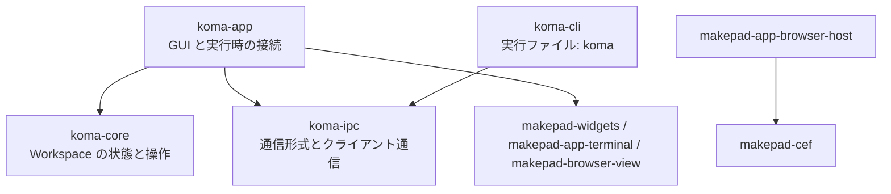
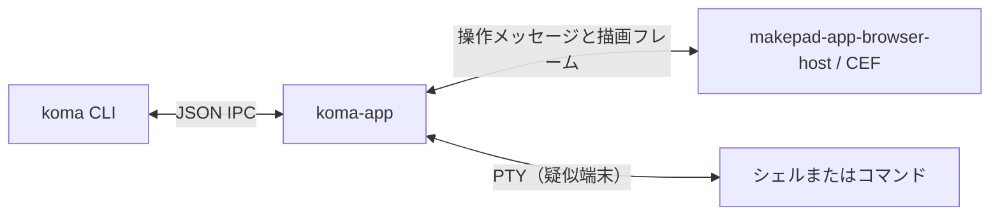

# Koma のアーキテクチャ

用語は [GLOSSARY.md](GLOSSARY.md)、設計判断は [ADR](docs/adr/)、ソースからの起動手順は [開発環境](docs/development.md) を参照。

## Cargo の依存境界

[ルートの Cargo.toml](Cargo.toml) はワークスペースを定義する。
Koma のアプリと CLI は4つのパッケージに分かれる。`koma-browser-host` と `koma-cef-fetch` は同じ Makepad フォークを参照する起動用パッケージ、[xtask](xtask/) はリリース補助用のワークスペースタスク。
下図の矢印は主なビルド時の依存を表す。

- [koma-core](crates/koma-core/) は外部クレートに依存しない。Sheet の一覧と選択位置は Core の操作か検証付きの復元を通じて設定する。
- [koma-cli](crates/koma-cli/) と [koma-ipc](crates/koma-ipc/) は JSON の処理に `makepad-micro-serde` を使うが、Makepad の GUI に依存しない。`koma-ipc` は通信形式とクライアント通信に加え、共通の [`WebDOM.js`](crates/koma-ipc/assets/WebDOM.js) と [`workspaces`](crates/koma-ipc/src/workspaces.rs) のパス解決も持つ。
- [koma-app](crates/koma-app/) が Core の操作を呼び、画面と保存を同期する。キールーティング、Palette の候補生成、設定に加え、[`persistence.rs`](crates/koma-app/src/persistence.rs) による `state.json`・`site_permissions.json` の保存と、[`runtime/platform.rs`](crates/koma-app/src/runtime/platform.rs) への OS 固有処理（外部 URL 起動や macOS FFI）の隔離もこのパッケージに置く。
- `koma-app` は Browser Host と通信するが、Host や CEF に依存しない。Browser Host も Koma のクレートに依存しない。

## 実行時のプロセス境界

下図の線はプロセス間の通信を表す。

- **Profile**：永続 Profile ごとに GUI プロセスを持ち、状態とブラウザデータを分離する。[Profile の保存先](crates/koma-app/src/runtime/profiles.rs) のロックで二重起動を防ぎ、起動済みの Profile には専用の IPC エンドポイントで前面表示を依頼する。
- **CLI**：[IPC クライアント](crates/koma-ipc/src/transport.rs) がリクエストを送り、GUI 側の [IPC サーバー](crates/koma-app/src/runtime/ipc_server.rs) が受け取る。サーバーはキューと `SignalToUI` で UI スレッドに処理を渡す。
- **Web Koma**：[WebViewRuntime](crates/koma-app/src/runtime/web_views.rs) が `makepad-browser-view` を使う。`makepad-browser-view` は最初のビューを開くときに別プロセスの Browser Host を起動し、共有テクスチャ経由でフレームを受け取る。
- **Terminal Koma**：[SheetStrip](crates/koma-app/src/ui/sheet_strip.rs) が GUI プロセス内に `MpTerm` を持つ。`makepad-app-terminal` のターミナルセッション はシェルまたはコマンドを子プロセスとして起動し、PTY 経由で入出力する。

GUI の起動は [`main.rs`](crates/koma-app/src/main.rs) の `app_main!(App)` から [`App`](crates/koma-app/src/ui/app/mod.rs) を経由して、[初期化処理](crates/koma-app/src/ui/app/lifecycle.rs) に進む。
